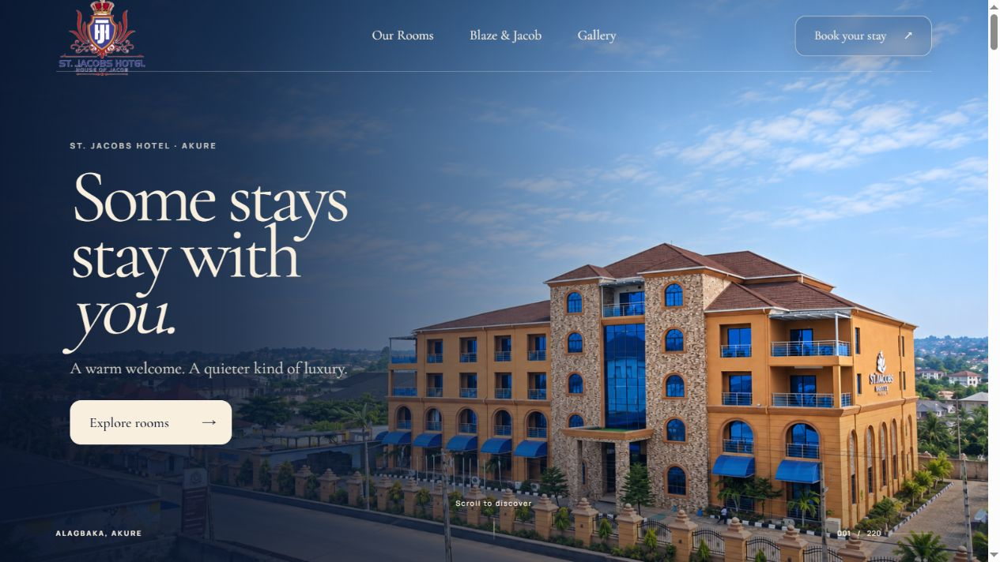
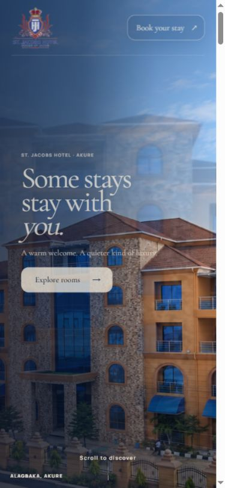

# St. Jacobs Hotel — immersive hospitality website

A custom, image-led hospitality experience for St. Jacobs Hotel in Akure, Nigeria. The site combines a cinematic scroll-controlled hotel tour with a complete room catalogue, facilities, dining, gallery, contact, reservation-request and booking-management experiences.

**Live experience:** [site-ruddy-gamma-89.vercel.app](https://site-ruddy-gamma-89.vercel.app/)



## Project highlights

- Static-first cinematic hero that waits for the visitor's first intentional downward scroll
- One responsive canvas rendering 220 ordered hotel frames with smooth forward and reverse playback
- Progressive frame loading: 30 priority frames first, followed by paced background batches
- Mobile-specific composition, touch stabilization and dynamic viewport handling
- Accessible reduced-motion experience and keyboard navigation
- Detailed room catalogue with verified order, dimensions and nightly rates
- Responsive booking flow with phone-number support and private booking lookup
- Original hotel photography, crest and brand palette throughout

## Technology

- Vite and vanilla JavaScript ES modules
- GSAP and ScrollTrigger
- Self-hosted Cormorant Garamond and Manrope fonts
- Supabase-backed reservation requests with atomic inventory checks and private guest lookup
- Netlify routing retained as an alternative deployment target

## Run locally

```powershell
npm install
npm run dev
```

For the local file-backed test API:

```powershell
npm run build
npm run serve:test
```

Open `http://127.0.0.1:5183/`.

## Build and verify

```powershell
npm test
npm run build
npm run test:browser
```

The production output is written to `dist/`.

## Routes

- `/`
- `/rooms/` and `/rooms/:slug/`
- `/annex/`
- `/facilities/`
- `/blaze-and-jacob/`
- `/about/`
- `/gallery/`
- `/contact/`
- `/booking/`
- `/blog/` and `/blog/:slug/`
- `/manage-booking/`

## Hero and loader

The homepage begins as a normal one-screen composition with frame 1 held still. The pinned sequence engages only after an intentional downward wheel, touch, keyboard or scroll gesture. A single canvas maps native scroll progress to 220 ordered WebP frames, uses interpolation for fluid playback, and plays in reverse when the visitor scrolls upward. The centered logo loader runs on each page load while the first 30 priority frames warm in the background. Reduced-motion visitors receive a static composition without the extended pinned sequence.



## Content and assets

Production assets live in `public/`. The gallery contains all 34 supplied hotel photographs with unique alternative text and category filters. Room names, order, dimensions and rates follow the approved project content in `src/content.js`.

## Vercel

`vercel.json` supplies the Vite build settings, pretty-route rewrites, caching and security headers. Files inside `api/` become Vercel Functions. See `DEPLOY-VERCEL.md` for publishing instructions and optional environment variables.

The build generates `public/sitemap.xml` and `public/robots.txt`. Set `SITE_URL` to override the default hotel domain.

## Reservations

The booking page is connected to the dedicated St. Jacobs Hotel Supabase project. It submits real reservation requests, checks configured room inventory, and gives each guest a private reference and access code. Requests begin as `pending_confirmation`; hotel staff confirm or decline them in Supabase. See `SUPABASE-SETUP.md` for staff operations and the remaining inventory configuration. Payment and automated email/WhatsApp delivery are separate integrations.

## Portfolio and asset note

This repository presents the website implementation as a portfolio case study. Hotel names, logos and photography remain the property of their respective owner and are included only to demonstrate the commissioned-style experience. The source code may be reviewed for evaluation; it is not offered as a reusable hotel template or asset pack.
